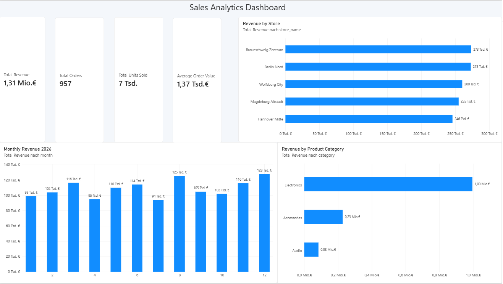

# Sales Data Warehouse & Analytics

## Project Overview

This project demonstrates an end-to-end data analytics workflow for a fictional retail company.

The goal is to integrate sales data from multiple sources, transform and validate the data using Python, store it in a SQL Server Data Warehouse, and analyze business performance through interactive Power BI dashboards.

## Technologies

- **Python:** Pandas, SQLAlchemy, pyodbc
- **Database:** Microsoft SQL Server
- **ETL:** Python-based Extract, Transform, Load pipeline
- **Data Modeling:** Star Schema (Fact and Dimension Tables)
- **Business Intelligence:** Microsoft Power BI, DAX
- **Version Control:** Git and GitHub

## Dashboard Preview



## Key Performance Indicators

- Total Revenue
- Total Orders
- Total Units Sold
- Average Order Value

## Business Analysis

- Monthly sales performance
- Revenue by product category
- Revenue by store
- Interactive filtering and analysis

## Data Architecture

The project follows a typical ETL (Extract, Transform, Load) architecture.

**1. Data Sources**
- Microsoft SQL Server: Orders and Order_Items
- CSV files: Customer and store information
- Excel file: Product information
- Synthetic sales data generated with Python

**2. Extract**
- Read SQL Server tables using Python and SQLAlchemy/pyodbc.
- Import CSV and Excel files using Pandas.

**3. Transform**
- Merge orders with order items.
- Calculate sales revenue (`quantity × unit_price`).
- Prepare and validate data for the Data Warehouse.

**4. Load**
- Load customer, product, store and date dimensions into SQL Server.
- Load sales transactions into the fact table.
- Avoid inserting existing records again when rerunning the ETL pipeline.

**5. Analyze**
- Connect Power BI Desktop to the SQL Server Data Warehouse.
- Create relationships between fact and dimension tables.
- Define DAX measures for business KPIs.
- Build interactive dashboards for sales analysis.

## Data Warehouse Schema

The Data Warehouse uses a **Star Schema**.

**Fact Table:**
- `Fact_Sales` — sales transactions, quantities, unit prices and revenue.

**Dimension Tables:**
- `Dim_Customer` — customer information.
- `Dim_Product` — product details and categories.
- `Dim_Store` — store locations.
- `Dim_Date` — calendar information for time-based analysis.

The fact table connects to the dimension tables through surrogate keys.

## ETL Execution

The Python ETL scripts are stored in the `etl/` directory.

The project includes a pipeline for extracting, transforming and loading data into the SQL Server Data Warehouse.

The ETL loading process supports repeated execution without inserting duplicate records.

## Installation & Usage

### Prerequisites

- Python 3.11 or newer
- Microsoft SQL Server
- SQL Server Management Studio (SSMS)
- Microsoft ODBC Driver 18 for SQL Server
- Power BI Desktop

### 1. Clone the Repository

```bash
git clone https://github.com/mokhtarrezaee1991/sales-data-warehouse.git
cd sales-data-warehouse
```

### 2. Create a Virtual Environment

On Windows using Git Bash:

```bash
python -m venv venv
source venv/Scripts/activate
```

### 3. Install Dependencies

```bash
pip install -r requirements.txt
```

### 4. Set Up SQL Server

Create the source database and Data Warehouse using the SQL scripts in the `sql/` directory.

The project uses two databases:

- `SalesSourceDB` — stores the original sales transactions.
- `SalesDataWarehouse` — stores the transformed analytical data.

The Python scripts use Windows Authentication to connect to the local SQL Server instance.

**Note:** The SQL Server instance name in the Python scripts may need to be adjusted for your environment.

### 5. Generate Synthetic Sales Data

```bash
python scripts/generate_sales_data.py
```

Import the generated orders and order items into the source database:

```bash
python scripts/import_sales_data.py
```

The generated data is fictional and intended for demonstration purposes.

### 6. Run the ETL Pipeline

```bash
python etl/run_pipeline.py
```

The pipeline executes the dimension and fact loading scripts in the required order.

It loads new records while avoiding duplicate inserts for unchanged source data.

### 7. Open the Power BI Dashboard

Open the Power BI report:

`powerbi/Sales_Dashboard.pbix`

If necessary, update the SQL Server connection in Power BI Desktop and refresh the imported data.

## Project Scope

This is a personal portfolio project built for learning and demonstrating practical skills in data engineering and business intelligence.

The project uses synthetic retail data and is not connected to a real company or production environment.